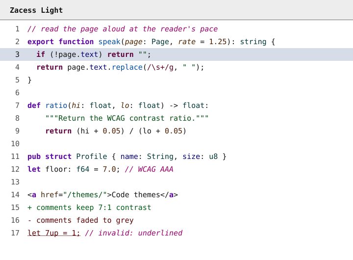
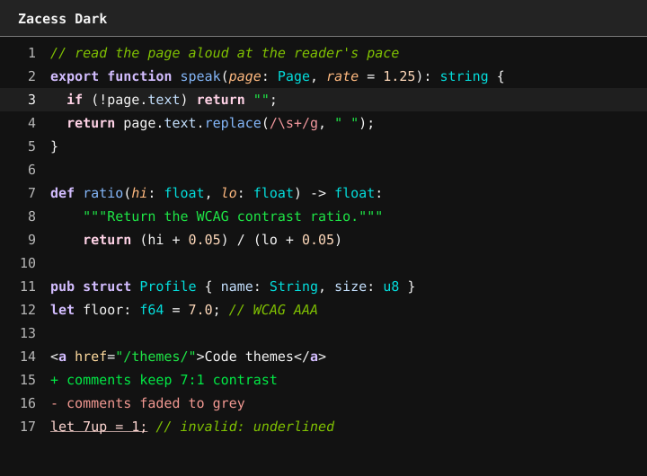
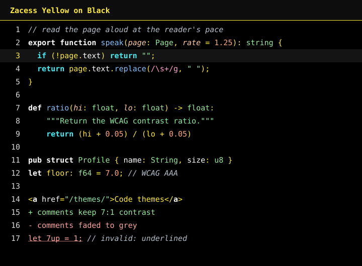
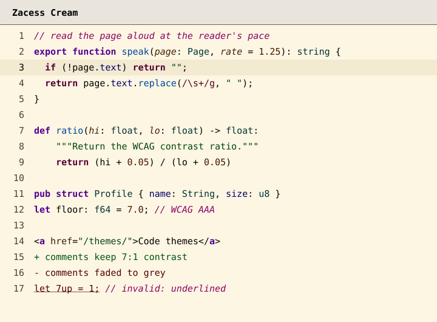
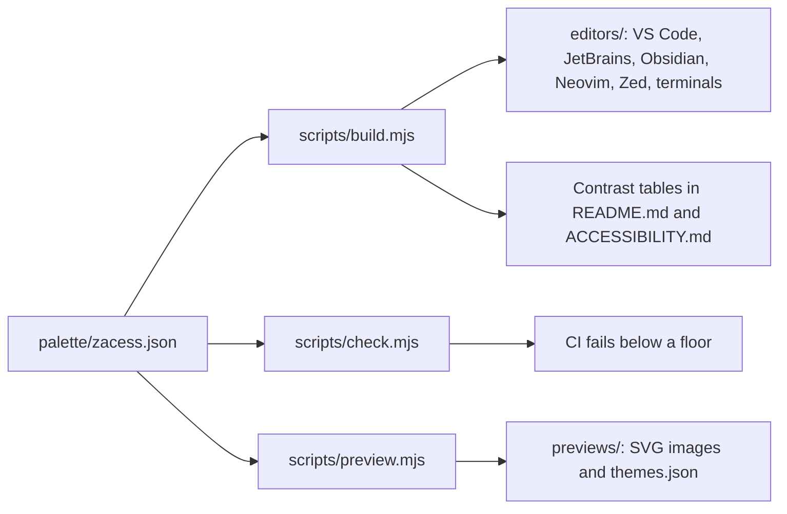

# Zacess themes

High contrast code themes that match the four contrast themes in the [Zacess](https://zacess.com)
reader, so a student sees the same page in the reader and in the editor. One palette is the source of
every colour. A small generator writes the files for each editor and the checks refuse any text or
syntax colour below 7:1 contrast (WCAG AAA).

Built for VS Code, JetBrains IDEs, Obsidian, Neovim, Zed, iTerm2, Alacritty, kitty, Ghostty and
Windows Terminal.

> [!NOTE]
> The VS Code Marketplace, Open VSX, JetBrains Marketplace and Obsidian community listings are not
> live yet. Until they are, install from the
> [latest release](https://github.com/zacesshq/themes/releases/latest) or from this repository as
> described below.

## The four themes

| Theme | Reader theme | For | Text on background |
| --- | --- | --- | --- |
| Zacess Light | Dark on light | Everyday use in a bright room | `#111111` on `#ffffff` |
| Zacess Dark | Light on dark | Everyday use in a dim room | `#f5f5f5` on `#121212` |
| Zacess Yellow on Black | Yellow on black | Low vision | `#ffeb3b` on `#000000` |
| Zacess Cream | Black on cream | Dyslexia friendly reading | `#000000` on `#fdf6e3` |









## Colour is never the only signal

- Keywords, control flow and markup tags are **bold**.
- Comments and parameters are *italic*. Comments are never dimmed below 7:1.
- Invalid code is underlined.
- Tokens that often sit side by side, such as strings and numbers or added and removed lines, differ
  in lightness or font style and not only in hue. Each pair is checked under simulated protanopia,
  deuteranopia and tritanopia.

## Contrast

Measured by `scripts/check.mjs` and written here by `scripts/build.mjs`, so the numbers are always
the ones CI enforced. Every ratio is rounded down.

<!-- contrast summary start: generated by scripts/build.mjs -->
| Theme | Text on background | Lowest syntax colour on background | Lowest syntax colour over the selection, current line or a diff |
| --- | --- | --- | --- |
| Zacess Light | `#111111` on `#ffffff`, 18.8:1 | 8.3:1 (comment) | 7.2:1 (comment on diffRemovedBackground) |
| Zacess Dark | `#f5f5f5` on `#121212`, 17.1:1 | 8.7:1 (removed) | 7.1:1 (removed on diffAddedBackground) |
| Zacess Yellow on Black | `#ffeb3b` on `#000000`, 17.1:1 | 11.0:1 (number) | 8.0:1 (number on selection) |
| Zacess Cream | `#000000` on `#fdf6e3`, 19.4:1 | 8.4:1 (added) | 7.3:1 (added on selection) |
<!-- contrast summary end -->

Every token in every theme, the interface colours, the terminal colours and the colour vision results
are listed in [ACCESSIBILITY.md](ACCESSIBILITY.md).

## Install

### VS Code

Download `zacess-themes-<version>.vsix` from the
[latest release](https://github.com/zacesshq/themes/releases/latest), then:

```sh
code --install-extension zacess-themes-0.1.2.vsix
```

Run **Preferences: Color Theme** (`Cmd+K Cmd+T` on macOS, `Ctrl+K Ctrl+T` elsewhere) and choose a
Zacess theme. Until the Marketplace listing is live, install the `.vsix` from the latest release.
Details are in [editors/vscode](editors/vscode/README.md).

### JetBrains IDEs

Download `zacess-themes-<version>.zip` from the latest release. In **Settings**, open **Plugins**,
select the gear icon, choose **Install Plugin from Disk...** and pick the zip. Then choose a Zacess
theme under **Appearance & Behavior**, **Appearance**. It needs an IDE on the IntelliJ Platform 2025.3
or later. Details are in [editors/jetbrains](editors/jetbrains/README.md).

### Obsidian

Copy `editors/obsidian/manifest.json` and `editors/obsidian/theme.css` into
`<vault>/.obsidian/themes/Zacess/` (the latest release also has them as `zacess-obsidian-<version>.zip`)
then choose **Zacess** under **Settings**, **Appearance**. Light and Dark follow Obsidian's own
setting. Yellow on Black and Cream are offered through the Style Settings plugin. Details are in
[editors/obsidian](editors/obsidian/README.md).

### Neovim

```sh
mkdir -p ~/.config/nvim/colors
cp editors/neovim/colors/*.lua ~/.config/nvim/colors/
```

Then set `vim.o.termguicolors = true` and run `vim.cmd.colorscheme("zacess-dark")` in `init.lua`.
Details are in [editors/neovim](editors/neovim/README.md).

### Zed

Run **zed: install dev extension** and choose the `editors/zed` folder. Copying
`editors/zed/themes/zacess.json` into `~/.config/zed/themes/` works too. Details are in
[editors/zed](editors/zed/README.md).

### Terminals

iTerm2, Alacritty, kitty, Ghostty and Windows Terminal files are in
[editors/terminals](editors/terminals/README.md), with the install step for each.

## How it works



1. [`palette/zacess.json`](palette/zacess.json) holds every colour: the interface, the syntax tokens
   and the 16 terminal colours of each theme, the font style of each token, the pairs of tokens that
   must look different and the floors the checks enforce. [`palette/schema.json`](palette/schema.json)
   describes its shape.
2. `npm run build` writes every editor's files from the palette. The generated files are committed,
   so each folder under `editors/` stands alone.
3. `npm run check` validates the palette against its schema, measures every colour against the floors
   below and parses every generated file. It prints a table of every failure and exits non-zero.
4. `npm run preview` draws the SVG previews as real text in each theme's colours and writes
   `previews/themes.json`, the data the themes page on the Zacess website is built from.
5. `npm run verify` runs the build and the previews again and fails if anything committed differs.

The checks need Node.js 24 and nothing else: the scripts have no dependencies.

| Rule | Floor |
| --- | --- |
| Every text and syntax colour on the background, the panels and bars, the selection, the current line and both diff backgrounds | 7:1 |
| The text colour over a find match | 7:1 |
| Every syntax colour over a find match, which also carries a border | 4.5:1 |
| Interface text: muted text, links, errors, warnings, information, line numbers and button text | 7:1 |
| Borders, dividers, focus outlines, indent guides and whitespace markers, on every surface they divide | 3:1 |
| Every terminal colour on the background | 7:1 |
| Every coloured terminal output against the terminal's default text: tone difference or OKLab distance in normal vision and under each simulation | 0.05 or 0.04 |
| Two paired tokens: tone difference (the cube root of relative luminance) | 0.05 |
| Two paired tokens under simulated protanopia, deuteranopia and tritanopia: OKLab distance | 0.04 |

The pair rules apply when two paired tokens share a font style. Pairs that are often red and green,
such as strings and numbers or added and removed lines, must meet them whatever their style.

## Layout

| Path | What lives there |
| --- | --- |
| `palette/` | The palette and its schema |
| `scripts/` | The generator, the checks, the previews and their shared colour maths |
| `editors/vscode/` | The VS Code extension |
| `editors/jetbrains/` | The JetBrains theme plugin and its Gradle build |
| `editors/obsidian/` | The Obsidian theme |
| `editors/neovim/` | The Neovim colour schemes |
| `editors/zed/` | The Zed theme extension |
| `editors/terminals/` | iTerm2, Alacritty, kitty, Ghostty and Windows Terminal themes |
| `previews/` | The preview images and the data for the website |
| `assets/` | The Zacess mark the icons are made from |

## Contributing

Change colours in `palette/zacess.json` only, then run the build, the checks and the previews. The
full workflow is in [CONTRIBUTING.md](CONTRIBUTING.md). A contrast or readability problem is a bug:
report it with the
[readability form](https://github.com/zacesshq/themes/issues/new?template=readability.yml).

## Licence

The themes are free to use under the [MIT licence](LICENSE).
