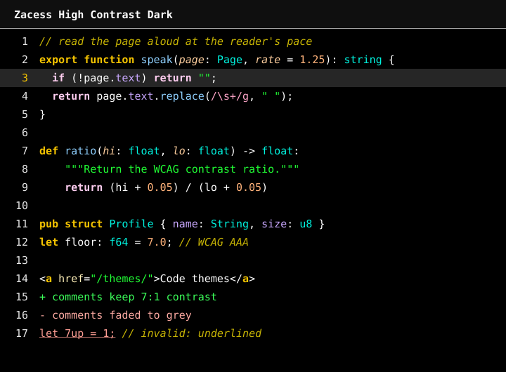
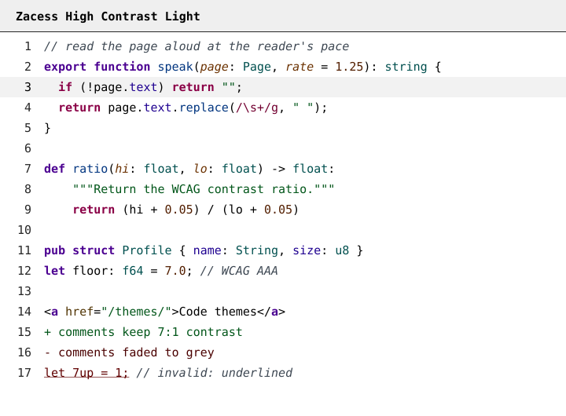
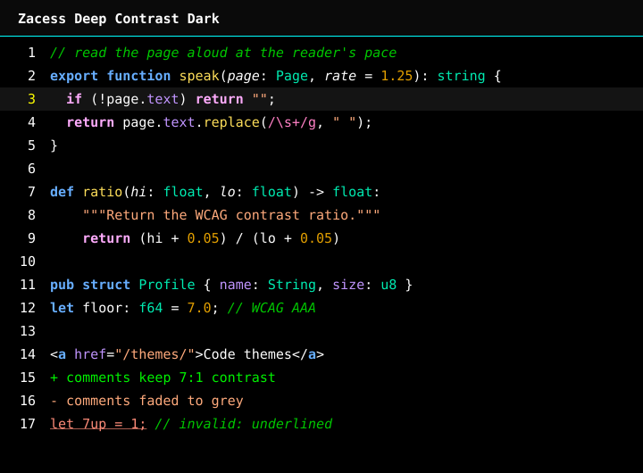
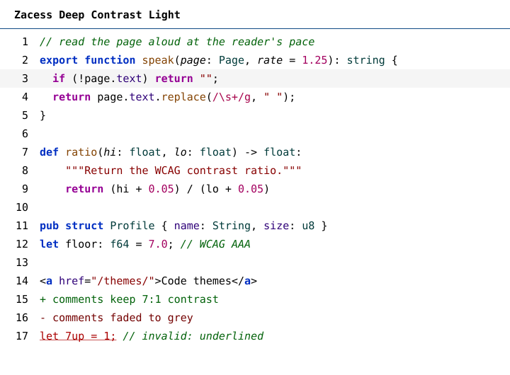

# Zacess themes

High contrast code themes that match the four contrast themes in the [Zacess](https://zacess.com)
reader, so a student sees the same page in the reader and in the editor, plus four maximum contrast
themes for anyone who needs the strongest contrast a screen can give. One palette is the source of
every colour. A small generator writes the files for each editor and the checks refuse any text or
syntax colour below 7:1 contrast (WCAG AAA) on the background.

Built for VS Code, JetBrains IDEs, Obsidian, Neovim, Zed, Sublime Text, Helix, Emacs, Eclipse,
Xcode, Terminal.app, iTerm2, Ghostty, kitty, WezTerm, Warp, Alacritty and Windows Terminal.

> [!NOTE]
> Zacess Themes is on the [VS Code Marketplace](https://marketplace.visualstudio.com/items?itemName=zacess.zacess-themes),
> [Open VSX](https://open-vsx.org/extension/zacess/zacess-themes), the [JetBrains Marketplace](https://plugins.jetbrains.com/plugin/35082-zacess-themes)
> and the [Eclipse Marketplace](https://marketplace.eclipse.org/content/zacess-themes-0) (in review there, installable now from the [update site](https://zacesshq.github.io/themes/eclipse/)).
> Zed lists it in the [Zed extension store](https://zed.dev/extensions?query=zacess). The Obsidian
> theme is in the [Obsidian community directory](https://community.obsidian.md/themes/zacess)
> and the Neovim schemes install from [zacesshq/zacess.nvim](https://github.com/zacesshq/zacess.nvim).
> Every editor can also be installed from the
> [latest release](https://github.com/zacesshq/themes/releases/latest) as described below.

## The eight themes

| Theme | Reader theme | For | Text on background |
| --- | --- | --- | --- |
| Zacess Light | Dark on light | Everyday use in a bright room | `#111111` on `#ffffff` |
| Zacess Dark | Light on dark | Everyday use in a dim room | `#f5f5f5` on `#121212` |
| Zacess Yellow on Black | Yellow on black | Low vision | `#ffeb3b` on `#000000` |
| Zacess Cream | Black on cream | Dyslexia friendly reading | `#000000` on `#fdf6e3` |
| Zacess High Contrast Dark | Light on dark | The highest contrast on a dark screen | `#ffffff` on `#000000` |
| Zacess High Contrast Light | Dark on light | The highest contrast on a light screen | `#000000` on `#ffffff` |
| Zacess Deep Contrast Dark | Light on dark | Low vision: deep, fully saturated colours on black | `#ffffff` on `#000000` |
| Zacess Deep Contrast Light | Dark on light | Low vision: vivid deep colours on white | `#000000` on `#ffffff` |










## Colour is never the only signal

- Keywords, control flow and markup tags are **bold**.
- Comments and parameters are *italic*. Comments are never dimmed below 7:1.
- Invalid code is underlined.
- Tokens that often sit side by side, such as strings and numbers or added and removed lines, differ
  in lightness or font style and not only in hue. Each pair is checked under simulated protanopia,
  deuteranopia and tritanopia.

## Accessibility

- **Selection:** selected text is a bold block in a colour from each theme's own palette, with every
  selected character at 7:1 or more wherever an editor or terminal lets a theme set it.
- **Where you are:** the cursor, the current line, find matches, the word under the cursor, a matched
  bracket and changed lines each have their own colour. The current find match is filled while the
  other marks are outlined, so none of them hides a character.
- **Contrast:** every text and syntax colour is 7:1 or more on the background. The full summary and
  the floors CI enforces are in [docs/contrast.md](docs/contrast.md).

[ACCESSIBILITY.md](ACCESSIBILITY.md) lists every token, every measurement and what each editor can draw.
Every colour of every theme is in [docs/palette.md](docs/palette.md).

## Install

| App | Install | Details |
| --- | --- | --- |
| VS Code | Search **Zacess Themes** in Extensions or run `code --install-extension zacess.zacess-themes`. Editors built on VS Code use [Open VSX](https://open-vsx.org/extension/zacess/zacess-themes) | [editors/vscode](editors/vscode/README.md) |
| JetBrains IDEs | **Settings**, **Plugins**, **Marketplace**, search **Zacess Themes** (IntelliJ Platform 2025.3 or later) | [editors/jetbrains](editors/jetbrains/README.md) |
| Obsidian | **Settings**, **Appearance**, **Themes**, **Manage**, search **Zacess** | [editors/obsidian](editors/obsidian/README.md) |
| Neovim | `{ "zacesshq/zacess.nvim", lazy = false, priority = 1000 }` with lazy.nvim | [editors/neovim](editors/neovim/README.md) |
| Zed | **zed: extensions**, search **Zacess Themes** | [editors/zed](editors/zed/README.md) |
| Sublime Text | Copy the `.sublime-color-scheme` files into `Packages/User` | [editors/sublime](editors/sublime/README.md) |
| Helix | Copy the themes into `~/.config/helix/themes/` | [editors/helix](editors/helix/README.md) |
| Emacs | Copy the `-theme.el` files into `~/.emacs.d/themes/` | [editors/emacs](editors/emacs/README.md) |
| Eclipse | **Help**, **Install New Software...** with the update site `https://zacesshq.github.io/themes/eclipse/` | [editors/eclipse](editors/eclipse/README.md) |
| Xcode | Copy the `.xccolortheme` files into `~/Library/Developer/Xcode/UserData/FontAndColorThemes/` | [editors/xcode](editors/xcode/README.md) |
| Terminals | Run the installer below in the terminal to theme | [editors/terminals](editors/terminals/README.md) |

Every file is also in the [latest release](https://github.com/zacesshq/themes/releases/latest) for an
offline install. [docs/recommended-settings.md](docs/recommended-settings.md) has the settings that
switch with the system light and dark setting and keep terminal text readable.

The terminal installer works out which terminal it runs in (Terminal.app, iTerm2, Ghostty, kitty,
WezTerm, Warp, Alacritty or Windows Terminal), copies all eight themes to the folder that terminal
reads and prints the one step that turns one on. It never edits a configuration file.

```sh
curl -fsSL https://raw.githubusercontent.com/zacesshq/themes/main/install.sh | bash
```

In Windows Terminal, run this in PowerShell instead:

```powershell
irm https://raw.githubusercontent.com/zacesshq/themes/main/install.ps1 | iex
```

All eight themes are also in the [iTerm2 Color Schemes](https://github.com/mbadolato/iTerm2-Color-Schemes)
collection, which Ghostty, WezTerm and Windows Terminal theme lists draw from. To make shell syntax
highlighting follow the active theme, see [docs/shell-colours.md](docs/shell-colours.md).

## How it works

One palette, [`palette/zacess.json`](palette/zacess.json), holds every colour. `npm run build` writes
every editor's files from it, `npm run check` measures them against the floors and `npm run preview`
draws the images above. The pipeline and the repository layout are in
[docs/how-it-works.md](docs/how-it-works.md).

## Contributing

Change colours in `palette/zacess.json` only, then run the build, the checks and the previews. The
full workflow is in [CONTRIBUTING.md](CONTRIBUTING.md). A contrast or readability problem is a bug:
report it with the
[readability form](https://github.com/zacesshq/themes/issues/new?template=readability.yml).

## Licence

The themes are free to use under the [MIT licence](LICENSE).
