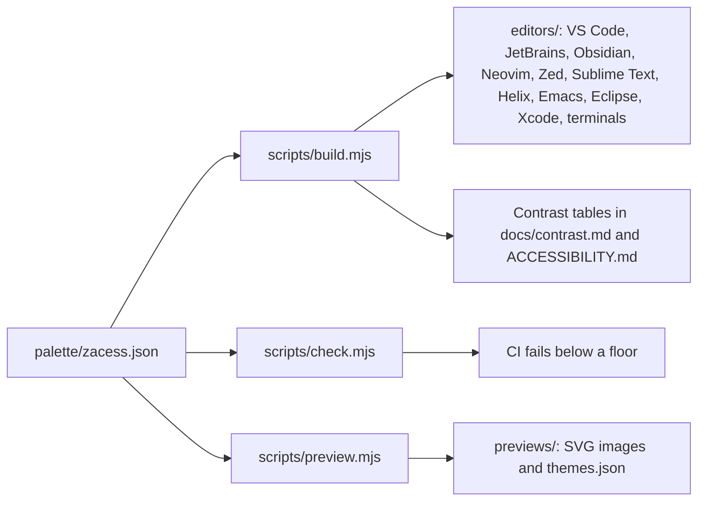

# How it works

1. [`palette/zacess.json`](../palette/zacess.json) holds every colour: the interface, the syntax tokens
   and the 16 terminal colours of each theme, the font style of each token, the pairs of tokens that
   must look different and the floors the checks enforce. [`palette/schema.json`](../palette/schema.json)
   describes its shape.
2. `npm run build` writes every editor's files from the palette. The generated files are committed,
   so each folder under `editors/` stands alone.
3. `npm run check` validates the palette against its schema, measures every colour against the floors
   in [contrast.md](contrast.md#the-floors) and parses every generated file. It prints a table of every failure and exits non-zero.
4. `npm run preview` draws the SVG previews as real text in each theme's colours and writes
   `previews/themes.json`, the data the themes page on the Zacess website is built from.
5. `npm run verify` runs the build and the previews again and fails if anything committed differs.

The checks need Node.js 24 and nothing else: the scripts have no dependencies.

## Layout

| Path | What lives there |
| --- | --- |
| `palette/` | The palette and its schema |
| `scripts/` | The generator, the checks, the previews and their shared colour maths |
| `editors/vscode/` | The VS Code extension |
| `editors/jetbrains/` | The JetBrains theme plugin and its Gradle build |
| `editors/obsidian/` | The Obsidian theme |
| `editors/neovim/` | The Neovim colour schemes |
| `editors/zed/` | The Zed theme extension |
| `editors/sublime/` | The Sublime Text colour schemes |
| `editors/helix/` | The Helix themes |
| `editors/emacs/` | The Emacs themes |
| `editors/eclipse/` | The Eclipse preference files, the Eclipse plugin and its Maven and Tycho build |
| `editors/xcode/` | The Xcode themes |
| `editors/terminals/` | Terminal.app, iTerm2, Ghostty, kitty, WezTerm, Warp, Alacritty and Windows Terminal themes |
| `install.sh`, `install.ps1` | The terminal installers |
| `previews/` | The preview images and the data for the website |
| `assets/` | The Zacess mark the icons are made from |
