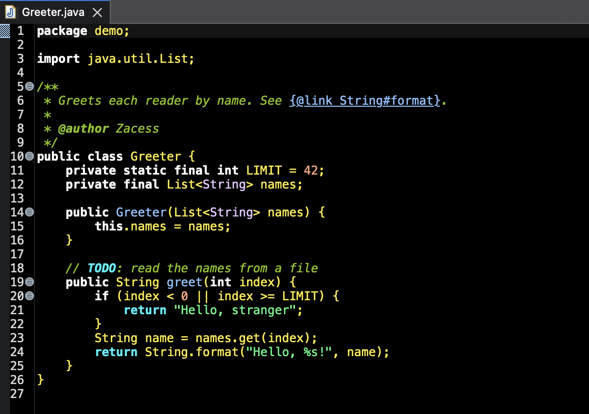

# Zacess for Eclipse

Eight preference files, `Zacess Light`, `Zacess Dark`, `Zacess Yellow on Black`, `Zacess Cream`,
`Zacess High Contrast Dark`, `Zacess High Contrast Light`, `Zacess Deep Contrast Dark` and
`Zacess Deep Contrast Light`, in Eclipse's `.epf` preference export
format. Each sets the Java editor's syntax colours and font styles, Javadoc and task tags, Java
semantic highlighting, the properties file editor and the colours every Eclipse text editor shares:
background, text, selection, current line, line numbers, print margin, links, marked occurrences,
search results, problem underlines, quick diff marks, linked mode, content assist and hovers. They
also set the Terminal view's 16 colours, text, background and selection.

Every key in the files was confirmed against Eclipse 4.41 (2026-09). An older or newer Eclipse
ignores any key it does not know.

## Install from the update site

The `com.zacess.themes.eclipse` plugin adds the eight themes to Eclipse's own theme list, so no file
needs importing. Each Zacess theme brings the Eclipse Light or Dark window with it and the same
editor and Terminal colours as its `.epf` file, plus Console colours from the palette.

1. Open **Eclipse** and choose **Help**, **Install New Software...**.
2. Select **Add...**, enter `Zacess Themes` as the name and this location, then select **Add**:

   ```text
   https://zacesshq.github.io/themes/eclipse/
   ```

3. Tick **Zacess Themes**, select **Next**, accept the MIT licence and select **Finish**.
4. Eclipse asks whether to trust the plugin, which is not signed. Select **Trust Selected** to carry
   on, then restart Eclipse when it asks.
5. Open **Preferences...** on macOS (**Window**, **Preferences** on Windows and Linux), then
   **General**, **Appearance**. Choose a Zacess theme under **Theme**, select **Apply and Close**
   and restart Eclipse so every open editor picks up the colours.

Choosing a Zacess theme replaces the colours it covers, those from an imported `.epf` file included.
Choosing another theme afterwards, Zacess or Eclipse's own, puts that theme's colours back. To
remove the plugin, open **Help**, **About Eclipse IDE**, **Installation Details**, select **Zacess
Themes** and **Uninstall...**.



The plugin was installed from the update site in Eclipse 4.41 (2026-09) on macOS, with Zacess Dark,
Zacess Cream and Zacess Yellow on Black checked in the Java editor. It holds no code, only
stylesheets for Eclipse's theme engine, so other Eclipse 4 releases and Windows and Linux should
work but have not been tested.

## Install a preference file by hand

Eclipse draws its window, views and toolbars from its own appearance theme, so pick the one that
matches the Zacess theme first:

| Zacess theme | Eclipse appearance |
| --- | --- |
| Zacess Light | Light |
| Zacess Dark | Dark |
| Zacess Yellow on Black | Dark |
| Zacess Cream | Light |
| Zacess High Contrast Dark | Dark |
| Zacess High Contrast Light | Light |
| Zacess Deep Contrast Dark | Dark |
| Zacess Deep Contrast Light | Light |

1. Open **Eclipse**, **Preferences...** on macOS (**Window**, **Preferences** on Windows and
   Linux), then **General**,
   **Appearance** and choose the **Theme** from the table. Select **Apply and Close** and restart
   Eclipse if it asks.
2. Choose **File**, **Import...**, then **General**, **Preferences** and select **Next**.
3. Under **From preference file**, browse to the `.epf` file, keep **Import all** selected and select
   **Finish**.
4. Restart Eclipse so every open editor picks up the colours.

> [!IMPORTANT]
> Changing the Eclipse appearance theme rewrites the editor colours with that theme's own. After
> any change under **General**, **Appearance**, import the Zacess file again.

The files only add settings. They never clear the rest of your preferences, so importing one does
not undo your other choices. **Restore Defaults** on the **Java**, **Editor**, **Syntax Coloring**
page and on the **General**, **Editors**, **Text Editors** pages puts back Eclipse's own colours.

> [!TIP]
> Eclipse has no preference for the cursor colour. **General**, **Editors**, **Text Editors**,
> **Accessibility** has **Use custom caret** and **Enable thick caret**, which make the cursor easier
> to find.

## Known limits

- Eclipse does not switch editor colours when the operating system changes between light and dark.
  It picks Light or Dark from the system only when it starts with no theme chosen. That choice
  rewrites the editor colours as above. One Zacess theme is active at a time. To change, import
  another file or, with the plugin, choose another theme under **General**, **Appearance**.
- With the plugin, a dark Zacess theme does not take the extra dark colours that some plugins,
  such as Git and Compare, give Eclipse's own Dark theme alone. Their views keep their light
  colours. The `.epf` route on Eclipse's Dark theme keeps them.
- The Java editor colours `return` on its own. Every other keyword, `if`, `for` and `while`
  included, takes the keyword colour, so control flow is told apart from declarations only where
  the keyword is `return`. Both are bold.
- Search results and marked occurrences are boxed in the find match border colour instead of
  filled, because an Eclipse annotation has a single colour. The text keeps its own background and
  its full contrast. The box keeps at least 3:1.
- Deprecated names are struck through in the text colour, as in Eclipse's own scheme.
- The XML and Markdown editors in Eclipse IDE for Java Developers, like any other TextMate based
  editor, take their syntax colours from TextMate themes of their own, which these files do not
  change.
- Everything outside the editor, such as the Package Explorer, the Console and the toolbars, follows
  the Eclipse appearance theme rather than the Zacess palette.

All eight files and everything under `plugin`, `feature` and `site` are generated from
`palette/zacess.json` by `npm run build` at the root of the repository. Never edit them by hand.
`mvn verify` in this folder, with Maven and Java 21 or later, builds the plugin and the update site
in `site/target/repository`.
