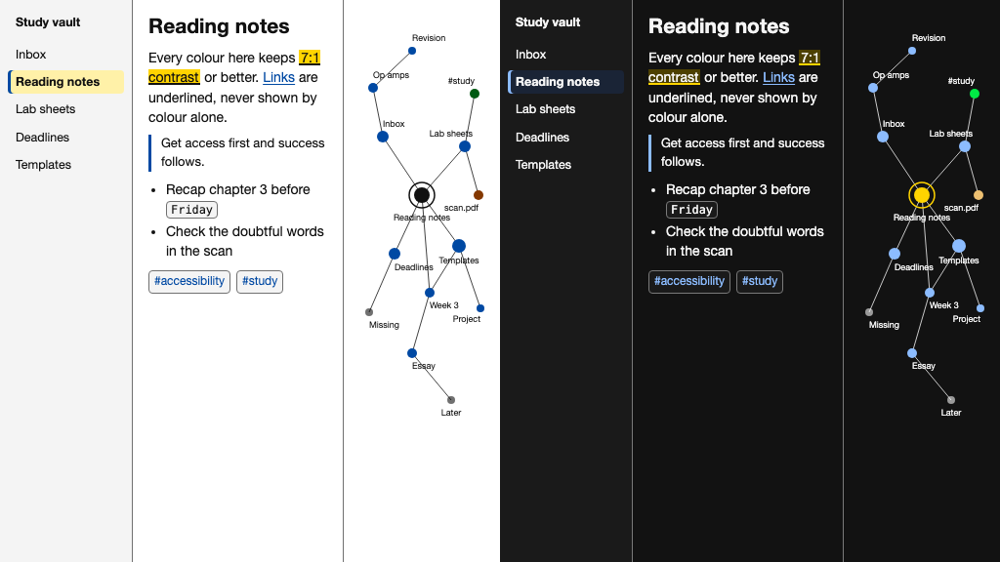

# Zacess for Obsidian

An Obsidian theme with Zacess Light for light mode and Zacess Dark for dark mode, the everyday
pair. Dark text on white by day and light text on near black at night, with every text and syntax
colour at 7:1 or more.
Obsidian's own **Base color scheme** setting switches between the two, so no plugin is needed.

The colours match the [Zacess](https://zacess.com) reader's contrast themes, so a page looks the
same in the reader and in your vault. The other four pairs are their own themes: Zacess Cream,
Zacess High Contrast, Zacess Deep Contrast and the gentler Zacess Warm.

## Install

Open **Settings**, then **Appearance**, select **Manage** under **Themes**, search for **Zacess** and
select **Install and use**.

To install by hand, put `manifest.json` and `theme.css` in a folder named `Zacess` inside your
vault's `.obsidian/themes/` folder and choose **Zacess** under **Appearance**, **Themes**.

## What the theme covers

Every surface Obsidian draws takes its colours from the Zacess palette: the editor in reading and
editing view, headings, links, lists, quotes, rules, inline code and code blocks, tables, embeds,
properties, footnotes, every callout type, the file explorer and every other tree, tabs, the ribbon,
dividers, the status bar, the title bar, menus, the command palette and every other prompt,
suggestions, modals, settings, notices, tooltips, inputs, toggles, sliders, the graph view, canvas,
Bases table, card and kanban views, the PDF viewer, Sync avatars and Mermaid diagrams.

Every text colour keeps 7:1 on every fill it can sit on, secondary text keeps 4.5:1 over a selection
or a hovered row and every border, outline, icon and mark keeps 3:1. Colour is never the only signal:
links are underlined, the active tab, the open file, a selected row and a selected suggestion carry a
bar, a highlight is underlined, a matched bracket is outlined and bold, a finished task is struck
through, callouts keep their icon and every control shows a focus ring.

## Releases

Each release matches a release of [zacesshq/themes](https://github.com/zacesshq/themes) with the
same version and carries `manifest.json` and `theme.css`. The full notes for every version are in
its [changelog](https://github.com/zacesshq/themes/blob/main/CHANGELOG.md).

## Where the theme is made

> [!NOTE]
> The theme is generated from one palette in [zacesshq/themes](https://github.com/zacesshq/themes),
> which also has the same themes for VS Code, JetBrains IDEs, Neovim, Zed and terminals. The
> read-only copy `zacesshq/obsidian-theme`, which Obsidian's theme directory installs from, is updated by
> each release. Issues, ideas and pull requests go to zacesshq/themes.

## Licence

[MIT](https://github.com/zacesshq/themes/blob/main/LICENSE)
